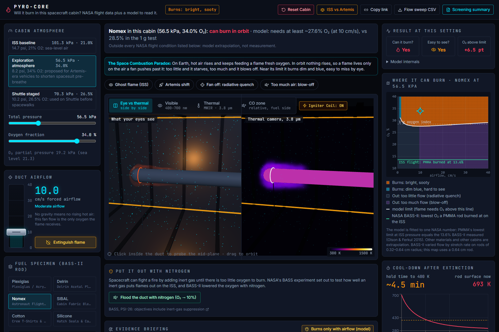

# PYRO-CORE

### Will this material catch fire in a spacecraft?

**NASA Space Apps Challenge 2026 · Challenge: _Flame in Freefall: SI-Powered Fire Safety Insights from Microgravity Combustion Data_**


---

## In one minute

On Earth, a flame heats the air around it, the hot air rises, and fresh air flows in from below. That is why a candle flame points upward and keeps burning.

**In orbit, nothing rises.** There is no "up" for hot air to go. A fire on a spacecraft only gets fresh oxygen from the air that the ventilation fans push past it. Three surprising things follow:

1. **A gentle breeze can keep a fire alive** that would otherwise smother itself. Too little air and it starves; too much and it is blown out.
2. **Some materials burn in orbit at lower oxygen levels than the standard ground test suggests.** NASA measured this on the International Space Station.
3. **Fires near their limit burn dim and blue.** They can be hard to see by eye, but a thermal camera picks them up.

Future spacecraft for the Moon (the Artemis program) are expected to use cabin air with **more oxygen (34%) at lower pressure** than the Space Station. That changes which materials can burn.

**PYRO-CORE lets anyone explore these questions:** pick a material, a cabin atmosphere and a fan speed, and see whether a flame can survive, what it looks like, and what NASA's real flight experiments say about it.

---

## What you can do with it

| | |
|---|---|
| **See the fire you can't see** | The 3D view shows the same burning rod twice, side by side: as your eyes see it and as a thermal camera sees it. |
| **One-click scenarios** | *Ghost flame*: a dim flame in Space Station air. *Artemis shift*: a fire-resistant fabric that can burn in the planned Moon-mission air. *Fan off*: the flame starves. *Too much air*: the flame blows out. |
| **Change the cabin** | Pick the Space Station, the planned exploration atmosphere, the expected Moon Base air (30% oxygen at 10.2 psi) or the Space Shuttle's pre-spacewalk setting, or set pressure and oxygen yourself. |
| **Change the fan** | Drag the airflow lever from still air to a strong breeze and watch the flame respond. |
| **Change the material** | Acrylic (Plexiglas), Delrin, Nomex (flight-suit fabric), SIBAL (a NASA test fabric), cotton and silicone. |
| **See where it can burn** | A map shows, for every fan speed and oxygen level, whether the flame can survive, with NASA's measured result drawn on it. |
| **Compare Space Station and Artemis** | A table shows every material in both cabins, and which ones change from "cannot burn" to "can burn". |
| **Put it out with nitrogen** | Flood the duct with nitrogen and see whether the flame can still burn. NASA tested this approach on the Space Station. |
| **Explore NASA's investigations** | 17 NASA microgravity combustion investigations (BASS, BASS-II, Saffire, SAME, DAFT, FLEX, FLEX-2, CFI, ACME BRE, CFI-G and E-FIELD, SPICE, SLICE, SoFIE, FLARE, LUCI, FM2), ranked for your habitat (spacecraft, Moon Base, Mars, Earth applications) and safety goal (prevention, detection, suppression, modelling), with the reasons shown and a side-by-side comparison of up to three. |
| **Read the evidence** | A briefing explains the result in plain words and lists the NASA flight measurements and experiments closest to your settings, with links. |
| **How long does it stay hot?** | After the flame goes out, a cool-down chart estimates how long the rod stays dangerously hot. |
| **Share a view** | "Copy link" saves exactly what you are looking at. |



---

## How to use it

1. **Open the app** ([live link](#links) or run it yourself, below). It starts with a plastic rod burning in Space Station air.
2. **Look at the two halves of the 3D view.** On the left the flame is faint; on the right, the thermal camera shows it clearly.
3. **Click a scenario button** above the 3D view to jump to an interesting case.
4. **Read the sentence at the top.** It says, in plain words, whether this material can burn in this cabin and whether that answer is backed by NASA flight data or is an estimate.
5. **Drag things.** Move the airflow lever, the oxygen slider, or the point on the map, and watch the flame and the verdict change.
6. Click **ISS vs Artemis** in the header for the comparison table.

---

## What is NASA data, and what is our model

We keep the two apart, and the app labels them everywhere.

| | Source | Shown as |
|---|---|---|
| **Measured on the Space Station** | NASA's BASS-II experiment burned acrylic rods in a small wind tunnel on the ISS. They kept burning down to **13.6% oxygen**, well below the 17.3% that the standard ground test suggests. | A green line on the map, and the "calibrated here" note |
| **NASA test records** | NASA's published table of BASS-II test conditions (if added, see below) | Green markers on the map and a test-log panel |
| **NASA experiments** | BASS, BASS-II, SoFIE, FLARE, FM2, FLEX, SAME, with links to NASA's pages | The evidence panels |
| **Our model** | A small physics model tuned so that acrylic matches NASA's 13.6% result | Every other number, marked "model" |
| **Handbook values** | Approximate material properties from fire-safety reference tables | Tagged "lit." (literature) or "est." (estimate) |

**Important:** only acrylic at Space Station pressure is checked against flight data. Results for other materials, and anything in the 34%-oxygen Artemis atmosphere, are estimates beyond what NASA has measured, and the app says so on screen. PYRO-CORE is a tool for exploring and learning, **not a safety certification or an operating procedure**.

---

## How it works (for the curious)

The model asks one question: **can the flame make heat faster than it loses it?**

- **Heat made.** Almost every material releases about the same heat per kilogram of oxygen it uses (13.1 MJ/kg, Huggett's rule). More oxygen in the air means a hotter flame.
- **Heat lost.** A flame radiates heat away. With very little airflow, it radiates away more than it can replace and goes out ("radiative quench").
- **Speed of the chemistry.** With too much airflow, the gas rushes past before it can react, and the flame blows off. This is measured by the *Damköhler number* (flow time ÷ reaction time), in the form NASA's researchers used to analyse BASS-II.
- **Calibration.** One constant is tuned so that acrylic's lowest burning oxygen at Space Station pressure equals NASA's measured 13.6%. Each other material is tied to its standard ground-test oxygen index in the same way.
- **Cool-down.** After the flame goes out, a simple heat-loss model estimates how long the rod surface stays hot.

The 3D flame is drawn with a GPU shader that follows the model's flame temperature and shape. It is a visual illustration, not a fluid-flow simulation.

<details>
<summary><b>Equations and constants (technical)</b></summary>

| Piece | Relation |
|---|---|
| Geometry | Rod of 0.635 cm radius burning at its upstream tip in axial flow, as in BASS-II. Stretch rate a = 3/2·U/R (Olson & Ferkul 2015). |
| Flame temperature | Huggett (1980): 13.1 MJ per kg of O₂ consumed, with a dilution factor of 1.5, giving about 2000 K in air before losses. |
| Radiative loss | R = ε σ (T_f⁴ − T∞⁴) / (ρ c_p U (T_ad − T∞)); T_f is the fixed point of T_f = T_ad − (T_ad − T∞) R/(1+R). |
| Chemistry | Da = B ρ Y_O₂ exp(−E/RT_f) / a; the flame needs Da ≥ 1. Scales with pressure through ρ. |
| Calibration | `U_ANCHOR` in `src/physics/constants.ts`, fitted so PMMA's minimum limiting O₂ at 101.3 kPa is 13.6%. `npm run check-physics` fails if this drifts. |
| Burning rate | Spalding B number with a Ranz–Marshall heat-transfer coefficient at the tip. |
| Cool-down | Lumped-capacitance cooling (convection plus radiation) from the pyrolysis temperature. |

</details>

---

## Limitations

- **One calibration point.** Only acrylic at Space Station pressure is fitted to flight data. Two other model constants are assumptions.
- **Artemis cabins are beyond the flight data.** BASS-II flew at Space Station pressure and 21% oxygen or less.
- **Material properties are approximate.** Values tagged "est." are estimates; check primary sources before any engineering use.
- **The 3D flame and the click-probe readings are an illustrative shape**, not a computational fluid dynamics result.
- **Not modelled:** partial gravity (Moon, Mars), because the model is calibrated in orbit and NASA has no partial-gravity flame data yet (FM2 is the first planned lunar experiment); and "cool flames", which NASA has observed with liquid fuel droplets (FLEX), not solid plastics.
- **The NASA test table records conditions, not outcomes**, so it shows what was tested, not whether each flame survived.

---

## Optional AI summary (Google Gemini)

The evidence briefing has an optional **AI summary** button. If you paste your own Google Gemini API key:

- the app sends **only** the briefing's list of facts (the cabin settings, the model's result, and the cited NASA findings) to Google's Gemini model `gemini-3.1-flash-lite`, through Google's OpenAI-compatible endpoint;
- Gemini writes a 3-sentence plain-English summary, shown labelled as AI-written;
- the app **automatically rejects** the summary if it contains any number that is not in the fact list, so it cannot introduce invented figures;
- the key is kept only in that browser tab's memory and sent only to Google; it is never saved or included in this repository.

Without a key nothing is sent, and the rule-based briefing (fixed rules, no AI) is the summary. The rankings and risk levels are always rule-based.

---

## Use of SI (AI) tools

As the NASA Space Apps rules require, here is where SI tools were used:

- **Code and documentation:** the application code, the physics implementation, this README and the demo slides were written with the help of an AI coding assistant (Claude, by Anthropic), directed, reviewed and tested by the team member listed below. The idea, the choice of challenge and the decisions about what to build are the team's own.
- **Data:** the AI assistant was used to find and read the NASA sources listed in this README. Every NASA number used in the app was checked against its cited source. **No data in this project was generated by AI.**
- **In the app:** the optional AI summary (Google Gemini) described above. Everything else in the app, including the rankings and risk levels, uses fixed rules and the physics model.

---

## Run it yourself

You need [Node.js](https://nodejs.org) 18 or newer.

```bash
npm install
npm run dev            # open http://localhost:5173
npm run build          # production build in dist/
npm run build:pages    # build for GitHub Pages (served at /pyro-core/); publish dist/ to the gh-pages branch
npm run check-physics  # prints limits for every material and cabin; fails if the NASA calibration drifts
```

**Optional NASA test table.** Download `PSI-25_Experimental table_BASS-II.csv` from the [BASS-II page on NASA's PSI repository](https://psi.nasa.gov/physci/repo/data/investigations/PSI-25) (Data files → Experimental table), rename it `bass2.csv`, and put it in `public/data/`. Without it, the app works and says the table is not loaded.

**Shareable views:** `/?flow=1.5` (dim flame, default), `/?flow=1.5&mode=mwir` (thermal only), `/?atm=eaa&mat=nomex&flow=10` (Nomex in the exploration atmosphere). Custom cabins use `p=<kPa>&x=<oxygen fraction>`.

---

## NASA data and resources used

| Resource | How PYRO-CORE uses it |
|---|---|
| **BASS-II: Burning and Suppression of Solids II**, NASA Physical Sciences Informatics (PSI) investigation PSI-25, [doi:10.60555/4qc4-de67](https://doi.org/10.60555/4qc4-de67), licence CC0-1.0 | Rod geometry, airflow range and tested conditions; the "BASS-II flight range" box on the map; optionally the experimental table (`PSI-25_Experimental table_BASS-II.csv`) for the test log. |
| S. L. Olson and P. V. Ferkul, *Microgravity Flammability of PMMA Rods in Concurrent Flow*, 9th US National Combustion Meeting, 2015, NASA Technical Reports Server [20150008961](https://ntrs.nasa.gov/citations/20150008961) | The calibration value (13.6% O₂), the 13.3% blow-off intercept, the 16.1% and 16.4% spread findings, the stretch-rate Damköhler form, and the hot-wire igniter description. |
| **BASS: Burning and Suppression of Solids**, PSI-26, [doi:10.60555/58h4-dy80](https://doi.org/10.60555/58h4-dy80), licence CC0-1.0 | Fuels, duct size and objectives (including inert-gas suppression) in the evidence panel and the nitrogen test. |
| NASA Space Apps 2026 *Flame in Freefall* challenge description | Investigation facts in the explorer (fuels, hardware, conditions, purpose, data status), the expected Moon Base atmosphere, and the Earth spin-offs. |
| NASA Glenn Research Center, [Combustion Science](https://www.nasa.gov/glenn/glenn-expertise-space-exploration/physical-sciences-program/combustion-science/) | Descriptions of SoFIE, FLARE, FM2, FLEX and SAME in the evidence panel. |
| NASA-STD-6001B (2011) | Referenced as the standard normal-gravity flammability test; the app is not a substitute for it. |

No NASA logos, insignia or other branding are used. PYRO-CORE is not a NASA product.

## Other references, data and tools

**Science references**

1. Olson, S. L., Ferkul, P. V. *Microgravity flammability boundary for PMMA rods in axial stagnation flow: Experimental results and energy balance analyses.* Combustion and Flame 180 (2017). doi:10.1016/j.combustflame.2017.03.001.
2. Huggett, C. *Estimation of rate of heat release by means of oxygen consumption measurements.* Fire and Materials 4 (1980) 61–65.
3. T'ien, J. S. *Diffusion flame extinction at small stretch rates: the mechanism of radiative loss.* Combustion and Flame 65 (1986) 31–34.
4. Ranz, W. E., Marshall, W. R. *Evaporation from drops.* Chemical Engineering Progress 48 (1952).
5. Spalding, D. B. *Some Fundamentals of Combustion.* Butterworths, 1955.
6. Material properties (heat of combustion, heat of gasification, oxygen index, density): approximate values from standard fire-safety and polymer property handbooks, tagged "lit." or "est." in the app.

**Software, fonts and services** (all used under their open licences)

| | Licence |
|---|---|
| React, React DOM | MIT |
| Three.js (3D rendering) | MIT |
| Recharts (charts) | MIT |
| Tailwind CSS (styling) | MIT |
| Lucide icons | ISC |
| clsx, tailwind-merge | MIT |
| Vite (build tool), TypeScript | MIT, Apache-2.0 |
| 3D simplex noise GLSL (Ashima Arts / Stefan Gustavson) | MIT |
| Inter and JetBrains Mono fonts, via Google Fonts | SIL Open Font License |
| Google Gemini API (optional AI summary, user-supplied key) | Google API terms |

No copyrighted images, audio or video are included. All screenshots in `docs/images` are of this app.

---

## For developers

| Path | Contents |
|---|---|
| `src/physics/` | Constants (including the BASS-II calibration values), material table, combustion engine, rule-based interpreter |
| `src/data/` | Investigation catalogue and ranking rule, NASA flight findings with sources, BASS-II table loader |
| `src/shaders/flameShader.ts` | GPU flame: visible, thermal and CO-zone views |
| `src/components/viewport/` | 3D duct, view toolbar, click probe |
| `src/components/analytics/` | Result card, flammability map, evidence briefing, test log, cool-down chart |
| `src/components/controls/` | Cabin, airflow lever, material, scenarios, nitrogen test |
| `src/components/export/` | ISS vs Artemis table, screening summary |
| `scripts/checkPhysics.ts` | Limits for every material and cabin; exits non-zero if the calibration drifts |

## Links

- **Live app:** https://sasikiran1.github.io/pyro-core/
- **Demo (7 slides, PDF):** [docs/PYRO-CORE-demo-slides.pdf](docs/PYRO-CORE-demo-slides.pdf)
- **Team:** Sasi Kiran Gottipati (solo team)

## Licence

MIT, see [LICENSE](LICENSE). NASA data used here is public domain (CC0) and cited above.
