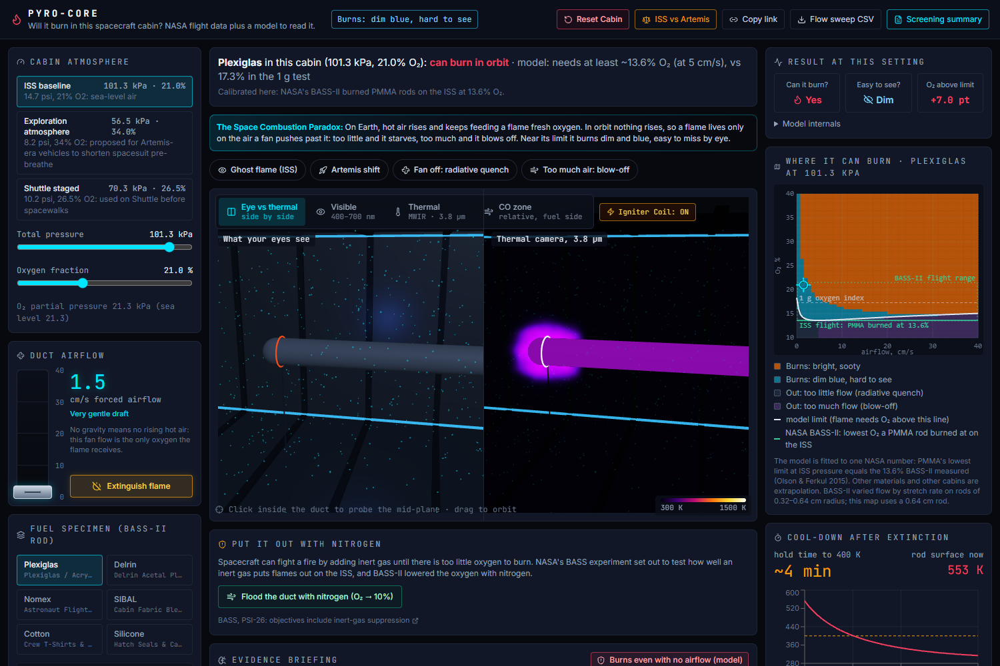
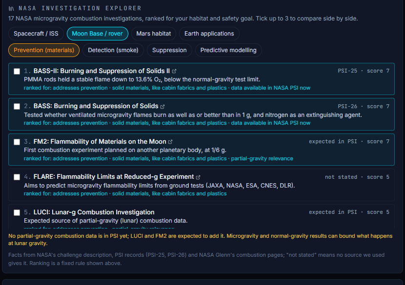
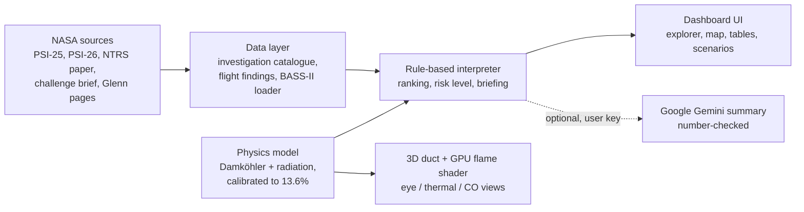

<div align="center">

# 🔥 PYRO-CORE

### Microgravity fire-safety explorer for human space exploration

**Will this material catch fire in a spacecraft, a Moon Base or a rover? What has NASA measured, and what is still unknown?**

[](https://sasikiran1.github.io/pyro-core/)
[-F59E0B?style=for-the-badge)](docs/PYRO-CORE-demo-slides.pdf)
[](LICENSE)

NASA Space Apps Challenge 2026 · Challenge: **Flame in Freefall: SI-Powered Fire Safety Insights from Microgravity Combustion Data**
Team: **Sasi Kiran Gottipati** (solo)



</div>

---

## Contents

1. [The problem](#1-the-problem)
2. [What PYRO-CORE does](#2-what-pyro-core-does)
3. [A 60-second tour](#3-a-60-second-tour)
4. [Key results](#4-key-results)
5. [How it works](#5-how-it-works)
6. [NASA data: what is measured and what is modelled](#6-nasa-data-what-is-measured-and-what-is-modelled)
7. [Quality and honesty checks](#7-quality-and-honesty-checks)
8. [Limitations](#8-limitations)
9. [Roadmap](#9-roadmap)
10. [Architecture and tech stack](#10-architecture-and-tech-stack)
11. [Run it locally](#11-run-it-locally)
12. [Sources, credits and licences](#12-sources-credits-and-licences)
13. [Use of SI (AI) tools](#13-use-of-si-ai-tools)

---

## 1. The problem

Fire is one of the most dangerous hazards in human spaceflight. Apollo 1, the Mir oxygen-generator fire and Apollo 13's oxygen-tank explosion all showed how quickly it can turn deadly far from help.

In orbit, fire behaves differently from on Earth:

- **Nothing rises.** On Earth, hot air rises and pulls fresh air into a flame. In microgravity there is no buoyancy, so a flame only gets the oxygen that the ventilation fans push past it. Too little airflow and it starves; too much and it blows out; in between, it keeps burning.
- **Materials can be more flammable than ground tests suggest.** NASA's BASS-II experiment kept acrylic burning on the International Space Station at **13.6% oxygen**, below the 17.3% that the standard normal-gravity test implies.
- **Near its limit, a flame burns dim and blue**, which is easy to miss by eye.
- **Future habitats will use more oxygen.** To shorten spacesuit pre-breathing, the planned Moon Base and pressurized rovers are expected to use **30% oxygen or more at 10.2 psi or less**, more than 40% more oxygen than Earth's air.

NASA has decades of microgravity combustion results in its Physical Science Informatics (PSI) database, but, as the challenge puts it, they are hard to find, harder to compare and harder still to interpret.

## 2. What PYRO-CORE does

PYRO-CORE is an interactive, browser-based dashboard that turns that research into clear answers.

| Feature | What it gives you |
|---|---|
| **NASA investigation explorer** | 17 NASA microgravity combustion investigations (BASS, BASS-II, Saffire, SAME, DAFT, FLEX, FLEX-2, CFI, ACME BRE, CFI-G and E-FIELD, SPICE, SLICE, SoFIE, FLARE, LUCI, FM2), **ranked** for your habitat (spacecraft, Moon Base or rover, Mars, Earth applications) and fire-safety goal (prevention, detection, suppression, predictive modelling). Every ranking shows its reasons, and up to three investigations can be **compared side by side** by fuel, hardware, conditions, measurements and data availability. |
| **Live flame simulator** | A 3D flow duct modelled on NASA's BASS-II hardware, with a polymer rod burning at its tip. Change the cabin, the material and the fan speed and the flame responds. |
| **Eye vs thermal camera** | The same moment rendered twice: as your eyes see it and as a 3.8 µm infrared camera sees it. Near-limit flames that are faint to the eye show up clearly. |
| **Where-it-can-burn map** | For every airflow and oxygen level, whether the flame can survive, with NASA's measured BASS-II result and tested range drawn on it. |
| **ISS vs Artemis comparison** | Every material's lowest burning oxygen in Space Station air and in the planned exploration atmosphere, and which materials switch from "cannot burn" to "can burn". |
| **Evidence briefing** | A plain-English verdict with a risk level, the closest NASA flight measurements for your settings, and an optional AI summary (Google Gemini) that is checked against the facts. |
| **Guided scenarios** | One click to a dim "ghost flame", the Artemis material shift, a flame starving when the fan stops, or one blown out by too much air. |
| **Suppression and cool-down** | Flood the duct with nitrogen to see whether the flame can survive, and estimate how long the rod stays hot after the flame goes out. |
| **Shareable and exportable** | "Copy link" saves the exact view; export a flow-sweep CSV or a plain-text screening summary. |



## 3. A 60-second tour

1. Open **https://sasikiran1.github.io/pyro-core/**. A plastic rod is burning in Space Station air at a gentle breeze.
2. Compare the two halves of the 3D view: faint to the eye on the left, clear to the thermal camera on the right.
3. Click **Artemis shift**: Nomex, a flight-suit fabric that cannot burn in Space Station air in the model, can burn in the exploration atmosphere.
4. Scroll to the **NASA investigation explorer**, choose **Moon Base / rover**, and tick two investigations to compare them.
5. Click **ISS vs Artemis** in the header for the whole material table.

## 4. Key results

Lowest oxygen at which each material can keep burning at any airflow, from the model. Only acrylic in Space Station air is matched to flight data; every other cell is an estimate.

| Material | Space Station<br>(21% O₂, 101.3 kPa) | Moon Base<br>(30% O₂, 70.3 kPa) | Exploration atmosphere<br>(34% O₂, 56.5 kPa) |
|---|---|---|---|
| Acrylic (PMMA) | 13.6% · **can burn** *(NASA-matched)* | 15.0% · **can burn** | 15.9% · **can burn** |
| Delrin (POM) | 11.9% · **can burn** | 13.0% · **can burn** | 13.8% · **can burn** |
| Cotton | 14.1% · **can burn** | 15.6% · **can burn** | 16.6% · **can burn** |
| SIBAL fabric | 14.5% · **can burn** | 16.0% · **can burn** | 17.1% · **can burn** |
| Silicone *(estimated values)* | 21.8% · cannot burn | 24.9% · **can burn** | 27.1% · **can burn** |
| Nomex (flight-suit fabric) | 22.2% · cannot burn | 25.4% · **can burn** | 27.6% · **can burn** |

**What this means:** lower cabin pressure makes a flame need slightly more oxygen, but the extra oxygen planned for the Moon and Artemis cabins outweighs it. In the model, two materials that cannot burn in Space Station air, **Nomex and silicone, can burn in both higher-oxygen cabins**. No NASA flight data covers those conditions yet, which is exactly the gap the app highlights.

## 5. How it works

### 5.1 The investigation explorer

Each investigation is a record of facts taken from NASA sources: objective, fuel, hardware, conditions, measurements, key finding, and whether its data is in PSI now. Anything a source does not state is shown as "not stated" rather than guessed.

Ranking is a transparent rule, and every point is shown to the user as a reason:

| Rule | Points |
|---|---|
| Addresses the chosen goal (prevention, detection, suppression, modelling) | +3 |
| Studies solid materials, for prevention (cabin fabrics and plastics) | +2 |
| Data already available in NASA PSI | +2 |
| Moon Base: highest-oxygen microgravity tests (ACME CFI-G, up to 85% O₂) | +2 |
| Moon or Mars: partial-gravity relevance (E-FIELD, LUCI, FM2) | +2 |
| Spacecraft: ventilated flow-duct experiments in the Microgravity Science Glovebox | +1 |
| Earth applications: linked to spin-offs (water-mist extinguishers, smoke detection) | +2 |

### 5.2 The flame model

The model asks one question: **can the flame make heat faster than it loses it?**

- **Heat made:** almost every material releases about 13.1 MJ per kilogram of oxygen it consumes (Huggett's rule), so more oxygen means a hotter flame.
- **Heat lost:** the flame radiates heat away. With very little airflow it loses more than it makes and goes out (*radiative quench*).
- **Chemistry speed:** with too much airflow, gas rushes past before it can react and the flame blows off. This is captured by the *Damköhler number* (flow time ÷ reaction time), in the stretch-rate form NASA's researchers used to analyse the BASS-II rods.
- **Calibration:** one constant is fitted so that acrylic's lowest burning oxygen at Space Station pressure equals NASA's measured **13.6%**. Each other material is tied to its standard ground-test oxygen index the same way.
- **Cool-down:** after the flame goes out, a heat-loss model estimates how long the rod surface stays hot.

<details>
<summary><b>Equations and constants</b></summary>

| Piece | Relation |
|---|---|
| Geometry | Rod of 0.635 cm radius burning at its upstream tip in axial flow, as in BASS-II. Stretch rate a = 3/2·U/R (Olson & Ferkul 2015). |
| Flame temperature | Huggett (1980): 13.1 MJ per kg of O₂, dilution factor 1.5, about 2000 K in air before losses. |
| Radiative loss | R = ε σ (T_f⁴ − T∞⁴) / (ρ c_p U (T_ad − T∞)); T_f is the fixed point of T_f = T_ad − (T_ad − T∞) R/(1+R). |
| Chemistry | Da = B ρ Y_O₂ exp(−E/RT_f) / a; the flame needs Da ≥ 1. Scales with pressure through ρ. |
| Calibration | `U_ANCHOR` in `src/physics/constants.ts`, fitted so PMMA's minimum limiting O₂ at 101.3 kPa is 13.6%. |
| Burning rate | Spalding B number with a Ranz–Marshall heat-transfer coefficient at the tip. |
| Cool-down | Lumped-capacitance cooling (convection plus radiation) from the pyrolysis temperature. |

</details>

### 5.3 Visuals

The 3D duct, airflow particles and flame are rendered with Three.js and a custom GPU ray-marching shader that follows the model's flame temperature and shape, with visible, thermal (ironbow) and CO-zone views. They are an illustration of the model, not a computational fluid dynamics result.

### 5.4 Optional AI summary (Google Gemini)

The evidence briefing has an optional **AI summary**. If you paste your own Gemini API key:

- the app sends **only** the briefing's fact list (cabin settings, model result, cited NASA findings) to `gemini-3.1-flash-lite` through Google's OpenAI-compatible endpoint;
- Gemini writes a 3-sentence plain-English summary, labelled as AI-written;
- the app **automatically rejects** the summary if it contains any number that is not in the fact list;
- the key stays in that browser tab's memory, goes only to Google, and is never saved or committed.

Without a key nothing is sent. Rankings and risk levels are always rule-based.

## 6. NASA data: what is measured and what is modelled

| Shown in the app | Where it comes from | How it is labelled |
|---|---|---|
| 13.6% O₂ minimum for acrylic rods | Measured on the ISS in BASS-II | Green line on the map; "calibrated here" |
| BASS-II tested range (about 14–21% O₂, up to 40 cm/s) | PSI-25 record | Dashed box on the map |
| Investigation facts in the explorer | Challenge description, PSI-25, PSI-26, NASA Glenn pages | Source named on each record |
| Every other number | The physics model | Marked "model" |
| Material properties | Fire-safety and polymer handbooks | "lit." (literature) or "est." (estimate) |

## 7. Quality and honesty checks

- **Calibration guard:** `npm run check-physics` recomputes every material in every cabin and **fails** if acrylic's limit drifts more than 0.2 points from NASA's 13.6%.
- **Extrapolation warnings:** whenever a cabin is outside the conditions NASA flew, the app says so on screen.
- **No invented data:** individual BASS-II test points were not typed in from a chart; only values stated in NASA's text are used. Unknown investigation fields read "not stated".
- **Guarded AI:** the optional Gemini summary is rejected if it introduces a number not in the facts.
- **Not a certification:** the screening summary states it is not a NASA document, a NASA-STD-6001B result or a flight rule.

## 8. Limitations

- **One calibration point.** Only acrylic at Space Station pressure is fitted to flight data; two other model constants are assumptions.
- **Moon, Mars and Artemis cabins are beyond the flight data.** BASS-II flew at Space Station pressure and 21% oxygen or less.
- **Partial gravity is not modelled.** There is no partial-gravity combustion data in PSI yet; LUCI and FM2 are expected to add it.
- **Approximate material properties.** Values tagged "est." are estimates.
- **Cool flames are not modelled.** NASA has observed them with liquid fuel droplets (FLEX, CFI), not solid plastics.
- **The 3D flame and click-probe readings are illustrative**, not a CFD solution.

## 9. Roadmap

- Load NASA's full PSI experimental tables (starting with BASS-II's, which the app can already read from `public/data/bass2.csv`) and plot every test.
- Fit the model to many measured outcomes instead of one, and show its error.
- Add Saffire, SoFIE and ACME BRE results to the explorer as data, not just descriptions.
- Add partial-gravity results when LUCI and FM2 data reach PSI.

## 10. Architecture and tech stack



| Layer | Technology |
|---|---|
| UI | React 18, TypeScript, Tailwind CSS, Lucide icons |
| 3D and visual effects | Three.js, custom GLSL ray-marching shader |
| Charts | Recharts, HTML canvas |
| Build and hosting | Vite, GitHub Pages |
| Optional AI | Google Gemini API (OpenAI-compatible endpoint) |

Everything runs in the browser; there is no server.

## 11. Run it locally

You need [Node.js](https://nodejs.org) 18 or newer.

```bash
npm install
npm run dev            # open http://localhost:5173
npm run build          # production build in dist/
npm run build:pages    # build for GitHub Pages (served at /pyro-core/); publish dist/ to the gh-pages branch
npm run check-physics  # every material and cabin; fails if the NASA calibration drifts
```

**Optional NASA test table.** Download `PSI-25_Experimental table_BASS-II.csv` from the [BASS-II page on NASA PSI](https://psi.nasa.gov/physci/repo/data/investigations/PSI-25) (Data files → Experimental table), rename it `bass2.csv`, and put it in `public/data/`. The app then plots the tested conditions and lists the nearest tests.

**Shareable views:** `/?flow=1.5` (dim flame), `/?flow=1.5&mode=mwir` (thermal only), `/?atm=moonbase&mat=nomex&flow=10` (Nomex at the Moon Base), `/?atm=eaa&mat=nomex&flow=10` (exploration atmosphere). Custom cabins: `p=<kPa>&x=<oxygen fraction>`.

| Path | Contents |
|---|---|
| `src/physics/` | Constants and calibration, material table, combustion engine, rule-based interpreter |
| `src/data/` | Investigation catalogue and ranking rule, NASA flight findings, BASS-II table loader |
| `src/shaders/` | GPU flame shader |
| `src/components/` | Viewport, analytics panels, controls, exports |
| `scripts/checkPhysics.ts` | Calibration check |

## 12. Sources, credits and licences

### NASA data and resources

| Resource | Used for |
|---|---|
| **BASS-II: Burning and Suppression of Solids II**, NASA PSI investigation PSI-25, [doi:10.60555/4qc4-de67](https://doi.org/10.60555/4qc4-de67), CC0-1.0 | Rod geometry, airflow range, tested conditions, optional experimental table |
| S. L. Olson and P. V. Ferkul, *Microgravity Flammability of PMMA Rods in Concurrent Flow*, 9th US National Combustion Meeting, 2015, [NTRS 20150008961](https://ntrs.nasa.gov/citations/20150008961) | 13.6% calibration value, 13.3% blow-off intercept, 16.1% and 16.4% spread findings, Damköhler form, igniter description |
| **BASS: Burning and Suppression of Solids**, PSI-26, [doi:10.60555/58h4-dy80](https://doi.org/10.60555/58h4-dy80), CC0-1.0 | Fuels, duct, objectives (including inert-gas suppression) |
| NASA Space Apps 2026 *Flame in Freefall* challenge description | Investigation facts in the explorer, expected Moon Base atmosphere, Earth spin-offs |
| NASA Glenn Research Center, [Combustion Science](https://www.nasa.gov/glenn/glenn-expertise-space-exploration/physical-sciences-program/combustion-science/) | Descriptions of SoFIE, FLARE, FM2, FLEX, SAME, SPICE, SLICE |
| NASA-STD-6001B (2011) | Referenced as the normal-gravity flammability test the app does not replace |

No NASA logos, insignia or branding are used. PYRO-CORE is not a NASA product.

### Science references

1. Olson, S. L., Ferkul, P. V. *Microgravity flammability boundary for PMMA rods in axial stagnation flow.* Combustion and Flame 180 (2017). doi:10.1016/j.combustflame.2017.03.001.
2. Huggett, C. *Estimation of rate of heat release by means of oxygen consumption measurements.* Fire and Materials 4 (1980) 61–65.
3. T'ien, J. S. *Diffusion flame extinction at small stretch rates: the mechanism of radiative loss.* Combustion and Flame 65 (1986) 31–34.
4. Ranz, W. E., Marshall, W. R. *Evaporation from drops.* Chemical Engineering Progress 48 (1952).
5. Spalding, D. B. *Some Fundamentals of Combustion.* Butterworths, 1955.
6. Material properties: approximate values from standard fire-safety and polymer property handbooks, tagged "lit." or "est." in the app.

### Software, fonts and services

| | Licence |
|---|---|
| React, React DOM, Three.js, Recharts, Tailwind CSS, clsx, tailwind-merge, Vite | MIT |
| TypeScript | Apache-2.0 |
| Lucide icons | ISC |
| 3D simplex noise GLSL (Ashima Arts / Stefan Gustavson) | MIT |
| Inter and JetBrains Mono fonts (Google Fonts) | SIL Open Font License |
| shields.io badges | CC0 |
| Google Gemini API (optional, user-supplied key) | Google API terms |

All screenshots are of this app. No copyrighted images, audio or video are included.

## 13. Use of SI (AI) tools

As the NASA Space Apps rules require, here is where SI tools were used:

- **Data:** the AI assistant was used to find and read the NASA sources listed here. Every NASA number used in the app was checked against its cited source. **No data in this project was generated by AI.**
- **In the app:** the optional Google Gemini summary described in section 5.4. Everything else, including rankings and risk levels, uses fixed rules and the physics model.

---

<div align="center">

**Team:** Sasi Kiran Gottipati (solo) · **Licence:** MIT, see [LICENSE](LICENSE) · NASA data is public domain (CC0) and cited above

</div>
